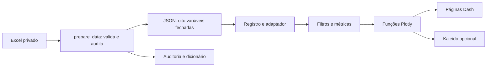

# Arquitetura

A entrada [app.py](../app.py) expõe `app` (Dash) e `server` (WSGI), orquestra a página única e os callbacks. O servidor não importa openpyxl, Kaleido nem PDFs. Os caminhos derivam da raiz do projeto em [config.py](../src/config.py), sem caminhos pessoais.

[registry.py](../src/datasets/registry.py) registra metadados e interface `loader() -> DataFrame`, `available() -> bool` e `supports(*fields) -> bool`. Apenas artefatos presentes entram no seletor. O adaptador valida a estrutura antes de retornar os registros. O dataframe da base é armazenado em cache por processo; filtros devolvem cópias, sem mutação do cache nem dados de sessão globais. Gunicorn usa dois processos, cada um com seu cache.

Figuras são funções independentes e reutilizadas no servidor, testes e exportação. Cada gráfico declara os atributos necessários; a página renderiza somente os gráficos compatíveis com a base. O agrupamento aplica-se apenas às dimensões suportadas; novas bases necessitam traduções e vocabulários próprios nos seus adaptadores/figuras — o contrato Liverpool não deve ser reaproveitado sem análise.

A página única está em `pages/dashboard.py`: quatro seções mostram os oito gráficos, sem navegação por abas, indicadores ou parágrafos explicativos. Filtros são entradas compartilhadas e o reset tem um único callback, evitando saídas duplicadas. `/_dash-update-component` é testado com requisição HTTP real no cliente Flask. `/healthz` verifica disponibilidade e carregamento do derivado.

## Extensão

1. Auditar fonte, consentimento, licença, riscos e perguntas da nova base.
2. Criar adaptador e contrato, incluindo política de ausências e variáveis disponíveis.
3. Registrar metadados e disponibilidade real; adicionar visualizações compatíveis por capacidade.
4. Escrever testes com referências da nova base.
5. Só criar comparação entre bases após avaliação explícita de equivalência conceitual, amostral e temporal.

O MVP não implementa comparabilidade automática, autenticação de usuários ou download de microdados. Não se deve publicar o derivado antes da autorização e revisão de reutilização descritas na auditoria.
